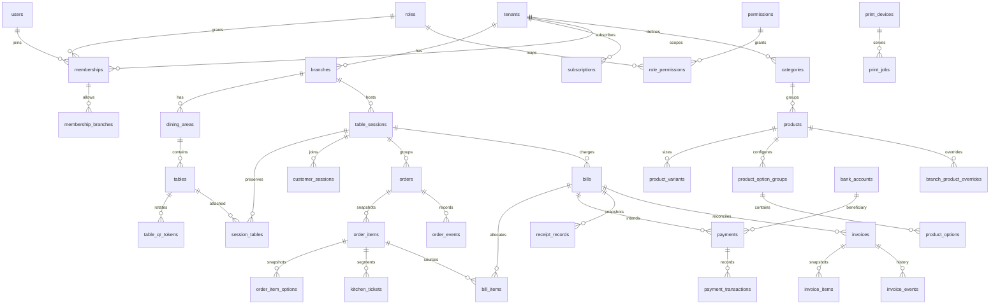

# Database design — D1/SQLite

Đề xuất 14/10/2026, chưa chạy migrations. Schema đủ cho roadmap; các bảng tạo theo phase, không triển khai tất cả cùng lúc.

## Quy ước và isolation

IDs TEXT random UUID, không dựa vào ID khó đoán để thay authorization. Money *_vnd INTEGER, >=0 trừ signed ledger; quantity INTEGER >0. UTC epoch milliseconds INTEGER; timezone IANA trên branch. Branch business date là local date tính từ UTC range [start,end), không substr UTC.

Mọi bảng data plane có tenant_id NOT NULL; dữ liệu branch có branch_id NOT NULL. Bảng tenant-scoped có UNIQUE(tenant_id,id); branch-scoped có UNIQUE(tenant_id,branch_id,id). Child FK phải chứa tenant và branch tương ứng. Ví dụ orders(tenant_id,branch_id,session_id) tham chiếu table_sessions(tenant_id,branch_id,id); FK order_items không chỉ tham chiếu order_id. Membership global user được kiểm tra riêng qua tenant membership. Tables global: users, permissions, user_sessions; roles chuẩn global read-only hoặc roles tenant local không trộn owner.

ON DELETE RESTRICT cho tài chính/menu đã được dùng; archive bằng archived_at/status. Product snapshots giữ nguyên khi đổi hoặc archive product. UI “xóa” product đã giao dịch thực hiện archive; ảnh unreferenced có delayed GC, không xóa logo snapshot tài chính cần lưu.

## ERD logic (một số bảng phụ trình bày trong inventory)

## Inventory — cột chính

Tất cả bảng tenant/branch data có created_at; mutable có updated_at và version INTEGER mặc định1. Các cột dưới đây thêm ngoài scope và timestamps. PK id trừ bảng join dùng composite key.

| Bảng | Scope | Cột chính, FK, constraints |
| --- | --- | --- |
| tenants | root | slug UNIQUE, name, logo_media_id, address, phone, status, timezone |
| subscriptions | tenant | plan_code, status, period_start/end, entitlements_json, provider_reference; không credential |
| branches | tenant | code UNIQUE(tenant_id,code), name, address, phone, timezone, status |
| users | global | normalized_email UNIQUE, password_hash, status; không expose hash |
| memberships | tenant | user_id FK users, role_id tenant FK, status; UNIQUE(tenant_id,user_id) |
| membership_branches | tenant+branch | membership_id tenant FK; PK(tenant_id,membership_id,branch_id) |
| roles | tenant | code UNIQUE(tenant_id,code), name, system_locked |
| permissions | global | code PK, description; system controlled |
| role_permissions | tenant | role_id tenant FK, permission_code global FK; composite PK |
| user_sessions | global | user_id, token_hash UNIQUE, expires_at, revoked_at, csrf_hash; token raw không lưu |
| dining_areas | branch | name, sort_order, archived_at |
| tables | branch | area_id scoped FK, code UNIQUE(tenant_id,branch_id,code), cleaning_state, archived_at |
| table_qr_tokens | branch | table_id scoped FK, token_hash UNIQUE, active, rotated_at; partial UNIQUE table active |
| table_sessions | branch | state open/closing/closed/voided, opened_by, closed_at, version; table lineage qua session_tables |
| session_tables | branch | session_id/table_id FK, attached_at, detached_at; partial UNIQUE active table |
| table_session_events | branch | session_id, type move/merge/open/close, source/target_id, actor, reason, payload_json |
| customer_sessions | branch | table_session_id FK, capability_hash UNIQUE, expires_at, revoked_at |
| categories | tenant | name, sort_order, archived_at |
| products | tenant | category_id scoped FK, name, description, base_price_vnd, status, sale_schedule_json, sort_order |
| media_objects | tenant | r2_key UNIQUE, mime, bytes, content_hash, status, uploaded_by; original_path không nhận client |
| product_media | tenant | product_id/media_id tenant FK, sort_order, alt_text |
| product_variants | tenant | product_id, name, price_delta_vnd, active; UNIQUE(tenant_id,product_id,name) |
| product_option_groups | tenant | product_id, name, min_select, max_select; min<=max |
| product_options | tenant | option_group_id, label, price_delta_vnd, active |
| branch_product_overrides | branch | product_id tenant FK, price_override_vnd nullable, available, schedule_json; UNIQUE scope+product_id |
| orders | branch | session_id nullable for takeaway, customer_session_id nullable, source qr/waiter/pos, status, subtotal_vnd, discount_vnd, surcharge_vnd, total_vnd, menu_revision, accepted_by |
| order_items | branch | order_id scoped FK, product/variant_id optional references, name_snapshot, unit_price_vnd, quantity, total_vnd, note, fulfillment_summary |
| order_item_options | branch | item_id scoped FK, option_id, name_snapshot, unit_delta_vnd |
| order_events | branch | order_id FK, event_type, from/to_state, actor_type/id, version, reason, payload_json; UNIQUE(order_id,version) scoped |
| kitchen_tickets | branch | item_id FK, station_id, quantity, state, queued_at, ready_at, served_at; không overwrite partial quantities |
| kitchen_stations | branch | name, printer_device_id nullable, active |
| bills | branch | session_id nullable, number UNIQUE branch+business_date+number, state, subtotal/discount/surcharge/total_vnd, frozen_at, settled_at, version |
| bill_items | branch | bill_id/item_id scoped FK, quantity, allocated_total_vnd, name/options/price_snapshot |
| bank_accounts | tenant | branch_id nullable default tenant, bank_bin TEXT, account_no TEXT, holder_name, active, archived_at; giữ số0 đầu |
| payments | branch | bill_id FK, method, state, requested_vnd, applied_vnd, bank_account_id, beneficiary_snapshot_json, transfer_reference UNIQUE, expires_at, version |
| payment_transactions | branch | payment_id FK, type collection/refund/reversal, amount_vnd, applied_vnd, unapplied_vnd, cash_change_vnd, external_reference, original_transaction_id, actor_id, happened_at, idempotency_ref |
| receipt_records | branch | bill_id FK, receipt_number UNIQUE branch, issued_at, kind original/copy/adjustment, bill_version, immutable_snapshot_json, actor_id |
| print_devices | branch | station_id nullable, purpose bar/cashier, transport usb/lan, paper_mm CHECK58/80, profile_json, active |
| print_agents | branch | name, credential_hash, paired_at, revoked_at, last_seen_at, permitted_devices_json |
| print_jobs | branch | device_id, agent_id, source_type/id/version, purpose, state, attempt_count, lease_token_hash, lease_until, dispatched_at, result_code, reprint_of nullable, reason, dedup_key UNIQUE scoped |
| print_job_events | branch | job_id FK, state/result, agent_id, attempt, details_redacted |
| invoices | branch | bill_id FK, provider, state, issue_key UNIQUE scoped, provider_id, original_invoice_id, totals_snapshot_json, submitted_at, issued_at |
| invoice_items | branch | invoice_id FK, immutable name/quantity/price/tax_snapshot; tax policy provider-approved |
| invoice_events | branch | invoice_id FK, type, request_id, provider_payload_redacted, happened_at |
| audit_logs | tenant + branch nullable | actor, action, resource_type/id, reason, before/after_redacted, request_id, occurred_at; append-only |
| idempotency_keys | tenant + branch nullable | actor_scope, route_scope, key_hash, request_hash, resource_id, status_code, response_redacted, expires_at; UNIQUE scope+actor+route+key |
| outbox_events | branch | aggregate_type/id/version, type, payload_json, status, retry_count, available_at; UNIQUE scope+aggregate+version+type |
| provider_webhook_events | tenant | provider, provider_event_id, signature_verified_at, payload_hash, state; UNIQUE tenant+provider+event |
| shifts | branch | opened_by, opened_at, closed_at, opening_cash_vnd, counted_cash_vnd, discrepancy_vnd |
| shift_payment_links | branch | shift_id/transaction_id scoped FK; UNIQUE transaction scope |

Combo extension: combo definitions và component snapshots ở phase2 nếu chủ dự án đưa vào MVP; không giả product_options đã đủ quản lý tồn kho/combo động. Thuế, discount, surcharge cần policy chốt; có bill adjustment snapshots, không lưu công thức mutable duy nhất.

## Indexes và uniqueness

- orders(tenant_id,branch_id,status,created_at,id); orders(tenant_id,branch_id,session_id,created_at).
- products(tenant_id,category_id,status,sort_order,id); overrides tenant+branch+product UNIQUE.
- order_items(tenant_id,branch_id,order_id); kitchen_tickets(scope,station_id,state,queued_at).
- bills(scope,state,created_at); receipt_records(scope,issued_at,id).
- payment_transactions(scope,happened_at,id); payments(scope,bill_id,state).
- invoices(scope,state,issued_at,id); audit_logs(tenant_id,branch_id,occurred_at,id).
- print_jobs(scope,device_id,state,available_at) — thêm available_at cho retry.
- outbox_events(scope,status,available_at,id); idempotency expiry index.
- Partial UNIQUE session_tables(tenant_id,branch_id,table_id) WHERE detached_at IS NULL; mỗi bàn tối đa1 session active.
- Partial UNIQUE bank default theo tenant/branch và currency; thêm is_default flag, tránh hai default active.
- Không index mọi cột vô tội vạ; kiểm tra EXPLAIN QUERY PLAN và rows_read/rows_written.

## Atomicity và concurrency

D1 batch gồm prepared statements được dùng làm atomic transaction; không giả transaction tương tác BEGIN/COMMIT giữa nhiều await. Nguồn: [D1 batch API](https://developers.cloudflare.com/d1/worker-api/d1-database/).

Read/validate rồi write không đủ. Transaction phải kiểm tra version/state/menu revision bằng SQL tại thời điểm commit:
1. guard claim/CAS có expected version; trigger RAISE(ABORT) nếu invariant/version sai, hoặc mọi writes gated và assertion SQL bắt buộc trước commit;
2. insert idempotency key và business rows;
3. events/audit/outbox cùng batch;
4. finalize persisted response/resource mapping.
Zero affected rows tự nó không rollback batch. Phải có guard/assertion được integration test chứng minh, không chỉ inspect result sau commit.

Concurrent submission: session guard open/version và branch menu revision guard; nếu thay giá/món thì 409 MENU_CHANGED cùng current values để khách xác nhận, không im lặng charge giá mới. Không dùng distributed lock trong JS Worker RAM.

Payment confirmation: guard frozen bill + intent version + due, unique key/reference và append ledger trong cùng batch. Refund check cumulative refund dưới lock/CAS, không vượt original collection. Table merge/split: multi-aggregate versions, allocations conserved, lineage events atomic.

Remote VietQR/provider/print không nằm trong D1 transaction. Outbox lưu intent cùng transaction, consumer idempotent; không tuyên bố exactly-once physical delivery.

## Migrations, seed và scale

File names 0001–0010 trong PLAN.md; mỗi file có FK/index/constraints và tests. Expand/contract schema; additive trước, backfill bounded, drop sau rollback window. Test fresh install, upgrade, foreign_key_check và uniqueness conflicts. Không transaction xuyên DB shards; tenant không trải một aggregate sang hai DB.

Seed explicit local/staging chứa hai tenant, role scopes, branch overrides, multi-customer session, refunded/partial bills và print unknown. Production provisioning không chạy demo seed.

Shared database backup/restore: PITR cả DB, hoặc export/restore vào DB cách ly rồi extract tenant qua closure FK, reconcile số row và ledger. Không restore whole shared DB để khôi phục một quán. D1 per-tenant vẫn kiểm tra tenant trong application và cần migration registry/provisioning, không tự tin isolation chỉ vì DB riêng.

Giới hạn cần sizing theo plan: [D1 limits](https://developers.cloudflare.com/d1/platform/limits/). D1 Free database500MB và Paid10GB; maximum bound parameters100/query, query deadline30s. Chia batch/item count phù hợp thay vì một query quá lớn.
