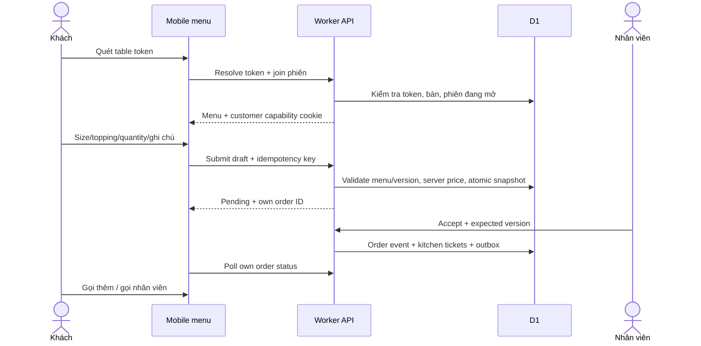
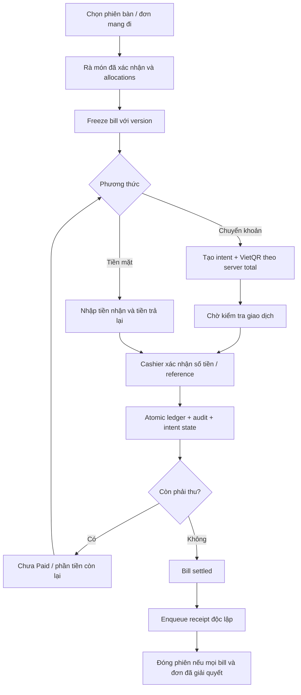

# Business flows & state machines

Trạng thái: đề xuất 14/10/2026. Commands ở API.md; dữ liệu ở DATABASE.md.

## Khách QR — không cần account

Đề xuất staff mở phiên bàn trước; QR không tự mở table session ở MVP. Nếu chưa mở, khách được xem menu và gọi nhân viên theo feature config, không tạo đơn. QR URL không có session ID tuần tự. Join capability gắn customer+tenant+branch+session+expiry; xem own orders mặc định, không đọc toàn bill bàn. Nhiều khách có cart riêng; gọi thêm tạo order mới liên kết session.

Mất mạng trước gửi: giữ cart cục bộ với scope phiên, ghi “Chưa gửi”. Timeout sau gửi: retry cùng idempotency key hoặc tra trạng thái cùng key; không đổi key để gửi lại. Token revoked/session closed thì capability không submit nữa; không đưa order vào phiên mới tự động.

## Nhân viên

Waiter thấy các bàn được phép, mở phiên, tạo đơn, xác nhận Pending và phục vụ. Chuyển bàn/gộp bàn dùng command có source/target version; giữ session events và lineage bàn. Barista không xem báo cáo doanh thu, staff hay bank settings.

Hủy Pending trước accept có quyền; sau Preparing manager quyết định và lưu lý do. Món đã thanh toán không được xóa/giảm snapshot; tạo reversal/refund cùng adjustment audit.

## Các máy trạng thái riêng

| Entity | States | Invariant |
| --- | --- | --- |
| Order | pending → accepted → preparing → ready → served → completed; cancelled | Payment không nhét vào preparation state; completed khi fulfillment terminal và bill được giải quyết |
| Order item | pending → queued → preparing → ready → served; cancelled | Quantity >1 có ticket segments để served/cancelled một phần |
| Table session | open → closing → closed; voided khi không có giao dịch | closed chỉ khi không còn nghĩa vụ thu tiền/đơn unresolved |
| Table operational status | available, occupied, ordering, waiting_payment, cleaning | View tổng hợp từ session + cleaning flag, không quyết định payment |
| Bill | open → frozen → settled; voided có điều kiện | frozen cấm sửa allocations/totals |
| Payment intent | pending → partially_paid → paid; expired/cancelled | Refund không rewrite lịch sử Paid |
| Payment transaction | recorded, reversed | Ledger append-only, refund entry tham chiếu entry gốc |
| Kitchen ticket | queued → preparing → ready → served; cancelled | Mỗi ticket có quantity segment, station, version |
| Print job | pending → printing → printed; failed hoặc unknown | unknown cần nhân viên kiểm tra trước reprint |
| Invoice | draft → submitting → issued; failed/unknown; adjusted/replaced/cancelled theo provider | Receipt không làm invoice issued |

Commands CAS expectedVersion; stale state trả 409. Repeated terminal command cùng key trả kết quả cũ. Cancelled/served quantities không vượt item quantity; mỗi item quantity được phân bổ đúng một lần cho bill hoặc reversal.

## Thu ngân và thanh toán

QR đang chờ cấm sửa frozen bill. Gọi thêm tạo bill open kế tiếp; không đổi amount/reference của intent cũ. Nếu cần đổi bill: cancel/expire intent chưa thu tiền rồi command tạo bill/intent mới có audit. Tiền đến sau expiry vẫn phải đối soát, không bỏ giao dịch.

Tách bill phân bổ order item quantities, không copy order thành hai giao dịch. Gộp bill chỉ khi cùng tenant/branch, bills open, chưa intent active/ledger. Giá snapshot, discount/surcharge allocation deterministic largest remainder integer; sum allocations = total. Chuyển/gộp bàn không xóa event hay session gốc.

Manual payment phân biệt amountReceived, appliedAmount và cashChange. Tiền mặt đưa 200.000 cho bill115.000 thì thu áp dụng115.000, trả85.000. Chuyển khoản thừa giữ unapplied credit cần cashier xử lý; tiền thiếu không Paid. Mixed payment tắt mặc định, khi bật chỉ settled khi applied totals đủ due. Refund không tự reopen bàn hoặc đổi preparation state.

## Barista và printer failures

KDS đọc ticket theo station, order table snapshot, note và tuổi đơn. Poll delta rồi resync khi cursor hết hiệu lực; reconnect không replay “ready” thành ticket mới. In pha chế từ outbox sau accept, không trực tiếp từ click UI.

Print fail không rollback thanh toán/accept. Pending retry trước dispatch; mất certainty sau send chuyển unknown. Reprint explicit tạo job mới có parent job, reason, copy label và audit.

## Báo cáo và offline

Doanh thu bán = sum accepted bill subtotal - discounts + surcharges; thuần = doanh thu bán - refund theo policy thời điểm được owner chốt. Thực thu = collections - cash change - cash-out refunds. Công nợ = bill due - applied collections; issued invoice totals là báo cáo riêng. Cancelled chưa bán không thành revenue.

PWA chỉ shell/menu cache public hợp lệ, không đồng bộ writes offline ở MVP. Checkout, payment confirm, transition cần online. Offline UI hiển thị dữ liệu cũ có thời điểm, không show success khi chưa có ACK API.
