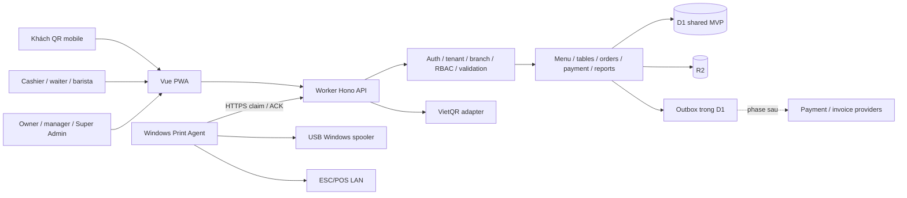

# Coffee POS & QR Ordering SaaS — Architecture & Implementation Plan

> Thực thi tại chat Codex hiện tại. Khi được duyệt, dùng executing-plans để triển khai từng task; không tự tạo chat khác hoặc chạy subagent.
>
> Trạng thái 14/10/2026: bản đề xuất để review. Chưa scaffold, chưa cài dependencies, chưa triển khai backend.

**Goal:** xây SaaS cà phê có tenant isolation, QR ordering, cashier POS, KDS, thanh toán và in USB/LAN tin cậy.
**Architecture:** modular monolith Hono trên Workers, D1 chung MVP, R2 cho ảnh, Vue PWA cùng origin. Domain modules độc lập; side effects qua outbox và Print Agent outbound.
**Tech Stack:** Vue 3 + TypeScript + Vite + Tailwind + Pinia + Vue Router; Workers + Hono + D1 + R2 + Zod + OpenAPI.
**Spec:** MASTER PROMPT do chủ dự án cung cấp, docs/CLIENT_BRIEF.md, DATABASE.md, API.md, FLOWS.md, PRINTING.md, SECURITY.md, DEPLOYMENT.md, TEST_PLAN.md.

## Global constraints

- Không code trước khi kế hoạch được chủ dự án duyệt; chọn/mix mockup trước build frontend.
- Không tự mua dịch vụ hoặc triển khai production; không VPS/Firebase/Supabase.
- Tenant/branch và quyền lấy từ ngữ cảnh được backend xác minh; client không quyết định giá.
- VND INTEGER; timestamps UTC; tài chính append-only, không hard-delete.
- QR tạo ra không đồng nghĩa đã thu tiền. MVP cashier xác nhận thủ công.
- Không giả gửi email, xác thực, in thành công hoặc phát hành hóa đơn thật.
- Dữ liệu thử chỉ ở local/staging riêng; production không seed dữ liệu giả.
- Không cache dữ liệu nhạy cảm giữa tenant; không nhận đơn/tiền offline ở MVP.

## Review focus

1. Hai tenant có ID trùng hình thức: mọi đọc/ghi/exports/agent API đều scope đúng; test ISO-01/02.
2. Gửi lại sau timeout hoặc cùng key khác payload: chỉ một nghiệp vụ, conflict rõ; test IDEM-01/02.
3. Nhiều khách gửi đồng thời, thu ngân chốt bill cùng lúc: không mất món hay đổi số phải thu; test CON-01/02.
4. Máy in nhận bytes nhưng agent mất ACK: trạng thái unknown, không tự in lại; test PRINT-03.
5. QR đã hiển thị hoặc tiền thiếu/thừa: chưa tự Paid, không làm sai doanh thu; test PAY-01/03 và REP-01.

## Kiến trúc và lựa chọn

Đề xuất **D1 chung MVP**: ít tài nguyên, migration đơn giản, tiện atomic domain transaction cùng tenant. Đổi lại một quán tải cao ảnh hưởng các quán khác và backup chung cần phục hồi từng tenant cẩn thận.

**D1 per-tenant**: giảm blast radius, phục hồi riêng và scale ngang; đổi lại provisioning, mapping database, migration fleet và binding giới hạn phức tạp. **Hybrid**: control plane SaaS chung, data plane phân shard/tenant; phù hợp khi đo tải cho thấy cần, chưa cần ở MVP.

Không có RLS tự động được giả định. Repository bắt buộc TenantContext + composite FK. D1Resolver giữ interface resolve(tenantId): D1Database để chuẩn bị shard; không nhận database ID từ client. Đề xuất review shard khi DB 60% dung lượng giới hạn, p95 transaction >500ms kéo dài hoặc overloaded xuất hiện; đây là ngưỡng vận hành nội bộ, không SLA Cloudflare.



MVP polling delta có cursor, foreground KDS khoảng 5s với jitter/backoff; customer status khoảng 10s, dừng khi tab ẩn. Đây là cấu hình đề xuất phải đo tải. SSE đơn giản nhưng giữ connection và reconnect cần kiểm thử. WebSocket + Durable Objects phù hợp fan-out/coordination khi có nhu cầu, thêm chi phí và vận hành. Không dùng realtime transport làm nguồn sự thật.

## Cấu trúc dự kiến — chưa tạo scaffold

```text
apps/web/src/
  app/                     router, role shells, PWA policy
  features/{menu,tables,orders,kds,payments,reports,staff,settings,saas}/
  data/                    typed fixtures và adapter, frontend phase
apps/api/src/
  middleware/              auth, context, permissions, rate limits
  modules/{identity,tenants,menu,tables,orders,kitchen,payments,printing,invoices,reports,subscriptions}/
  repositories/            tenant-scoped D1 access
  infrastructure/          D1 resolver, R2, provider clients, outbox
apps/api/migrations/       migrations numbered immutable
apps/print-agent/src/      pairing, jobs, spool ledger, printer adapters
packages/shared/src/      contracts, money, states, permissions
packages/ui/src/          Vue component primitives/tokens
packages/print-core/src/  receipt model, ESC/POS rendering, rasterization
tests/e2e/                role journeys
docs/                     brief, design selection, mockups, verification
```

API modules own transactions; frontend UI không import repository SQL. Print-core không phụ thuộc cloud; receipt snapshots versioned. Shared contracts không chứa secrets hoặc SQL. Pin exact dependency versions và lockfile tại lúc scaffold, kiểm tra runtime compatibility khi đó.

## Thiết kế trước thực thi

- [x] Đọc brief và khảo sát workspace.
- [x] Lập kiến trúc, schema đề xuất, API, flow, printing, security, deployment và test plan.
- [ ] Chủ dự án duyệt kế hoạch và các quyết định MVP.
- [ ] Chọn/mix 3 mockup A/B/C và lưu DESIGN_SELECTION.md.
- [ ] Viết docs/FRONTEND_PLAN.md theo thiết kế đã chọn.
- [ ] Build frontend fixtures, kiểm tra desktop/mobile; không tạo backend thật ở giai đoạn này.
- [ ] “Hết demo”: dọn fixtures/fake success và cập nhật backend plan từ code thực tế.

## Roadmap backend theo phase

Các phase dưới đây là kế hoạch, không phải việc đã chạy. Mỗi task thực hiện test thất bại → minimal implementation → test pass → review. Các lệnh pnpm bên dưới là target scripts sẽ tạo khi scaffold, hiện chưa tồn tại.

### Phase 1 — Foundation, identity, multi-tenancy

Dependencies: kế hoạch duyệt; schema/permissions đã chốt; Cloudflare local runtime.
Migrations: 0001_identity_tenancy.sql (tenants, subscriptions, branches, users, memberships, membership_branches, roles, permissions, role_permissions, user_sessions); 0002_operational_guards.sql (audit_logs, idempotency_keys, outbox_events).

- [ ] T1.1 Tạo workspace tooling trong package.json, pnpm-workspace.yaml, tsconfig.base.json; apps/api/src/index.ts và packages/shared/src/contracts.ts. Produces health response + shared error envelope. Test apps/api/test/health.test.ts asserts /healthz 200 without secrets; pnpm test:api -- health; pnpm typecheck và pnpm build phải exit 0.
- [ ] T1.2 Tạo migrations và apps/api/src/middleware/tenant-context.ts. resolveContext(session, tenantSlug, branchId): Promise<TenantContext> xác minh active membership/branch. Test apps/api/test/tenant-isolation.test.ts với cùng actor hai quán, foreign branch, joins, export; expected 404/403 và không ghi sai tenant.
- [ ] T1.3 apps/api/src/modules/identity/{routes,service}.ts và repositories/sessions.ts. authenticate(credentials): Promise<SessionGrant>, revokeSession(sessionId): Promise<void>; password hashing được benchmark dưới Workers CPU, không tự viết crypto. Test session rotation, expired/revoked cookie, CSRF, role revoked.
- [ ] T1.4 Tạo shell web login, branch picker, staff/roles cơ bản và OpenAPI từ Zod. Test API contract + role routing E2E. Account provisioning ban đầu do owner/admin có quyền, chưa public signup/email flow.

API: /auth/*, /me, /tenants/*, /branches/*, /staff/*.
UI: login, tenant/branch switch, owner settings, staff.
Tests/AC: ISO, RBAC, AUTH; không bypass guards; migrations fresh + upgrade chạy trên local D1; không sai tenant kể cả composite FK. Không commit secret.

### Phase 2 — Menu, tables, QR, POS

Dependencies: P1; thiết kế UI duyệt. Migrations: 0003_menu.sql, 0004_tables_orders.sql.
- [ ] T2.1 MenuRepository.list(ctx, filters), priceOrder(ctx, draft): Promise<PricedOrder> trong modules/menu và packages/shared/src/money.ts. Test apps/api/test/pricing.test.ts: 2×35000 + 45000 =115000; option khác product bị reject; out-of-stock/schedule/branch override; không nhận price client.
- [ ] T2.2 SessionService.open(ctx, tableId), joinFromQr(token, customerCookie), rotateQr(ctx, tableId). Bảng chỉ một active session; customer capability giới hạn own orders. Test QR-01/02 và session concurrent open.
- [ ] T2.3 OrderService.submit(ctx, customerScope, draft, idempotencyKey): Promise<OrderReceipt>; snapshot immutable và atomic idempotency/order/items/event/outbox. Test retry cùng key, key đổi payload, 20 khách cùng bàn, closing session conflict; apps/api/test/order-concurrency.test.ts.
- [ ] T2.4 Web customer menu/cart/status, waiter mobile, cashier menu/table/bill routes. Repository adapter chuyển từ fixtures sang API; UI không tin frontend route guard cho authorization. Test tests/e2e/qr-to-pos.spec.ts gồm mất mạng sau submit, status recovery.

API: public table resolve/session/menu/orders/calls, staff menu/tables/session/orders.
UI: menu management, bàn, QR menu, waiter mobile, cashier.
AC: staff xác nhận khách; không overwrite món khách khác; không lộ bill/notes khách khác; QR rotate vô hiệu token cũ; không offline submit.

### Phase 3 — KDS & lifecycle

Dependencies: P2. Migration: 0005_kitchen.sql.
- [ ] T3.1 OrderLifecycle.transition(ctx, orderId, command, expectedVersion), item state riêng; event + outbox atomic. Test ORDER-01, stale version409 và hủy theo permission.
- [ ] T3.2 KitchenService.listDelta(ctx, cursor, station), updateTicket(ctx, ticketId, state, version). UI KDS columns + elapsed time + text cảnh báo; cursor/backoff. Test KDS-01/02 và load polling.
- [ ] T3.3 Cancellation/refund request boundaries, unavailable item and partial served summaries; receipt/bar ticket source snapshot. Test trạng thái món không khiến payment Paid.

API: orders transitions/cancellations, kitchen tickets/delta.
UI: KDS, order detail/history.
AC: chuyển trạng thái hợp lệ có audit; khách không mutate trạng thái; KDS không mất event sau reconnect; p95 mục tiêu TEST_PLAN.

### Phase 4 — Payment, VietQR, receipt templates

Dependencies: P3 và nghiệp vụ bill/rounding chốt. Migration: 0006_billing_payments.sql.
- [ ] T4.1 BillingService.allocate(ctx, sessionId, items, version), freeze(ctx,billId,version): Promise<FrozenBill>. Test BILL-01/02: split conserved, new order không sửa frozen bill; all items accounted once.
- [ ] T4.2 PaymentService.createIntent(ctx,billId,method,key), confirmManual(ctx,paymentId,amountVnd,reference,key,version). Snapshot beneficiary, unique transfer reference và DB total. Test PAY-01/02/03, concurrent confirm, overpayment/refund ledger.
- [ ] T4.3 VietQrProvider.generate(intent): Promise<QrArtifact>, secret ở Worker, timeout và explicit QR generation failure. Receipt preview/download/print layout; test bank override, unique ref, exact amount.
- [ ] T4.4 RefundService.record(ctx,transactionId,amountVnd,reason,key); webhook interface future feature disabled. Test refund không vượt collected amount và reports theo ledger.

API: bills freeze/split/merge, payment intents/QR/manual-confirm/refunds, receipts.
UI: cashier payment, customer separate-device QR, receipt preview, bank settings.
AC: display QR không Paid; xác nhận amount đúng, actor/time/reference audit; print receipt không tự gọi là hóa đơn điện tử. Provider production cần account/terms review trước khi dùng thật.

### Phase 5 — Print Service & Windows Agent

Dependencies: P4; model máy in + Windows test device có thật. Migration: 0007_printing.sql.
- [ ] T5.1 packages/print-core/src/{model,escpos,raster}.ts; renderReceipt(snapshot,profile): Uint8Array, UTF-8 tiếng Việt qua raster theo thiết bị. Test snapshot 58/80mm và QR decode.
- [ ] T5.2 PrintJobService.enqueue(ctx,source,purpose,key), claim(agentId), acknowledge(agentId,jobId,leaseToken,result); device scoped credential + leases. Test PRINT-01/02/04.
- [ ] T5.3 Windows adapters + persistent local spool ledger; restart recovery, printer probe, paired outbound auth. Test PRINT-03/05 trên hardware; không đánh printed khi chỉ spooler accepted.
- [ ] T5.4 Settings device pairing, test print, queue, unknown state resolution, explicit reprint reason; HTML browser fallback khi agent lỗi.

API: print-devices, pairing, print-jobs, /agent/jobs/*.
UI: printer settings, queue, receipt.
AC: không open API in ra internet, không arbitrary command; unknown ACK không blind retry; validate hardware riêng USB/LAN.

### Phase 6 — Reports, shifts, audit

Dependencies: P4/P5 vận hành. Migration: 0008_reports_shifts.sql.
- [ ] T6.1 shift open/close + payment ledger attribution; ReportService.reconcile(ctx,range): ReconciliationReport. Test REP-01 discount/surcharge/refund/cash discrepancy; timezone boundary.
- [ ] T6.2 Indexed dashboard aggregates, top items, cashier/branch filters; CSV/Excel streaming với formula injection mitigation. Test cross-tenant exports and memory bounded range.
- [ ] T6.3 Audit views và error/agent metrics, redaction policy tests. Không expose secrets qua export.

API: reports, exports, shifts, audit.
UI: dashboard, reports, shift close.
AC: sales/collections/debt/invoices tách số; timezone chính xác; report totals reconciled fixture có refund/partial payment.

### Phase 7 — E-invoice provider

Dependencies: provider API/hợp đồng, thuế/quy trình được chủ dự án xác nhận; chưa phát hành thật.
Migration: 0009_invoices.sql.
- [ ] T7.1 InvoiceProvider + immutable invoice/items/events/request correlation; stub chỉ local, production disabled.
- [ ] T7.2 Provider request outbox, query-before-retry on uncertain outcome, callback verify/dedup; test INV-01/02 duplicate/no double issue.
- [ ] T7.3 Tra cứu, adjustment/replacement references, reconciliation UI; masked logs.
API: invoice drafts/issues/status/adjustments (issue production disabled until authorized).
AC: chưa có provider thì thao tác phát hành unavailable; không coi receipt là legal invoice.

### Phase 8 — SaaS subscriptions & hardening

Dependencies: phases cần launch pass; plan entitlements đã chốt. Migration: 0010_saas_entitlements.sql.
- [ ] T8.1 Super Admin tenant lifecycle + subscriptions/manual provisioning; entitlement enforcement backend. Không tự tích hợp thanh toán subscription trả phí.
- [ ] T8.2 Rate limits, backup/restore drill, quota metrics, abuse/load test, rollback/runbooks.
- [ ] T8.3 Auth/security review, production smoke và E2E toàn flow; test restore tenant từ shared DB không ghi đè tenant khác.
API: /platform/tenants, subscriptions, entitlements.
UI: Super Admin, subscriptions, operational health.
AC: tất cả TEST_PLAN launch gates; budget và production authorization còn phải được chủ dự án cấp.

## Lệnh kiểm tra dự kiến

pnpm lint; pnpm typecheck; pnpm test:unit; pnpm test:api; pnpm test:e2e; pnpm build.
D1 migrations: local fresh, upgrade từ snapshot phase trước, foreign_key_check. CI dùng env tách biệt; hardware tests không thay bằng unit mocks rồi tuyên bố in thật.

## Admin và dashboard — yêu cầu được bổ sung

Frontend sẽ có route /admin và landing /admin/dashboard ngay trong scope thiết kế/frontend, cùng trang quản lý sản phẩm, ảnh, giá, danh mục, size/topping, ngân hàng, bàn, máy in, nhân viên/quyền và settings theo permission. Không cần đợi phase6 mới đưa Admin vào frontend; phase6 là triển khai dữ liệu báo cáo backend hoàn chỉnh.

Dashboard chọn ngày và cơ sở: bill đã xuất, tiền thực thu từng cơ sở/ngày, cash/transfer/refund/debt, mở chi tiết bill và export. Bill bán hàng và e-invoice issued là hai tập dữ liệu riêng. Admin chỉ có quyền trong tenant/branch được cấp; Super Admin SaaS riêng.

T2.4 bổ sung frontend Admin products/images/catalog; T4.3 bổ sung bank settings; T6.2 bổ sung backend daily-summary và receipt listing/filter. Test ADMIN-01/02 và REP-02/03.

## Rủi ro, quyết định và bước tiếp theo

Xem docs/CLIENT_BRIEF.md cho câu hỏi mở, DEPLOYMENT.md cho tài liệu chính thức. Rủi ro chính: shared DB isolation, transaction race, ngân sách polling, in không có ACK vật lý, payment manual, hóa đơn chưa có provider, gián đoạn mạng.

Bước tiếp theo là review bộ tài liệu và chọn/mix mockup. Không tự hiểu việc xem mockup là duyệt kiến trúc hoặc thực thi backend.


## Cập nhật thực thi15/10/2026
Thiết kế A đã được người dùng chọn và frontend được yêu cầu build/tunnel. Kết quả và boundary thực tế ở docs/FRONTEND_SCOPE.md, kế hoạch frontend ở docs/FRONTEND_PLAN.md. Roadmap backend phase1–8 trong tài liệu này vẫn là kế hoạch, chưa triển khai Hono/D1/auth/provider/agent. Yêu cầu commit/push chỉ scope cafesaas, không thay đổi các dự án anh em.
