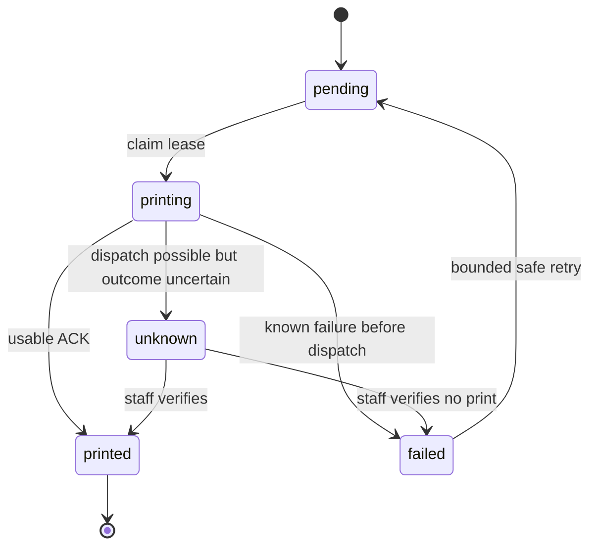

# Printing — Windows USB, Wi-Fi/LAN and receipts

Đề xuất 14/10/2026. Chưa có hardware hoặc Print Agent chạy thật.

## Ranh giới

Worker chỉ lưu và cấp print jobs qua HTTPS. Windows Agent trong quán truy cập USB spooler hoặc TCP printer LAN được cấu hình. Wi-Fi printer dùng LAN IP nếu hỗ trợ network ESC/POS. Bluetooth extension, không cam kết trước model.

Browser HTML print fallback dùng receipt 58/80mm và browser dialog; không silent print, không báo printed chỉ vì gọi window.print.

## Kiến trúc

- packages/print-core: immutable ReceiptModel/KitchenTicketModel; rendering ESC/POS hoặc bitmap, khổ giấy/profile.
- apps/api modules/printing: dedup enqueue, lease claim, audit, status; không raw arbitrary ESC/POS từ khách.
- apps/print-agent: pairing, outbound poll, printer allowlist, persistent spool ledger, Windows adapter, LAN adapter.
- Agent thường chạy Windows service/tray cấu hình local; không cần inbound internet port. Không spawn arbitrary shell command theo payload.
- Cấu hình device theo branch và purpose: cashier, bar hoặc cả hai qua explicit routing; printer profiles chỉ admin được sửa.

## Models và content

Kitchen ticket: table/order reference, item qty, size/options/note snapshot, acceptedAt, station, ticket reference. Không cần bank account.
Receipt: merchant/logo/address/hotline snapshot, receipt/bill number, UTC/timezone display, item qty/price/totals, discounts/surcharges, due, method, VietQR amount/ref/beneficiary, thank-you. Nếu chưa thanh toán in “Chưa thanh toán”; cashier confirmation receipt có actor/time.
Receipt là bill bán hàng; e-invoice là module/provider khác.

QR encoded/displayed amount phải đúng remaining due lúc freeze/intent. Bill paid không in QR yêu cầu thu thêm mà không label. Tách QR payment instruction và invoice lookup QR nếu provider phát hành sau này.

## Interfaces dự kiến

PrinterAdapter.probe(profile): Promise<PrinterHealth>.
PrinterAdapter.send(bytes,jobId): Promise<DispatchResult>.
RenderReceipt(model,profile): Uint8Array.
DispatchResult = accepted_by_spooler | sent_to_device | device_confirmed | failed_before_send | uncertain.
Receipt version, renderer version, device profile version và source version gắn job. ACK không nói chắc giấy đã ra nếu model không có status protocol.

USB: Windows spooler RAW đối với ESC/POS-compatible driver; kiểm chứng driver không thay bytes. Nếu printer GDI-only dùng raster Windows print path phù hợp. LAN: allowlisted local IP/port9100 theo device, không scan mạng; finite timeout và bounded payload. Không SSRF tới cloud metadata/arbitrary target.

Tiếng Việt phụ thuộc printer codepage; mặc định đề xuất raster hóa glyph Việt nếu chưa xác minh codepage. QR dùng native ESC/POS khi supported hoặc bitmap; scan-test cả58mm/80mm và cut margins.

## Pairing và credential

Owner/manager có printers.manage tạo short-lived single-use pairing code. Agent exchange outbound nhận opaque credential gắn tenant/branch/agent/device allowlist; server lưu hash, local lưu protected Windows credential store. Token expire/rotation/revoke; heartbeat không cho agent tự đổi branch.
Mọi job claim/result kiểm tra credential+device+lease+attempt. No cross-tenant job IDs. Nếu cần local UI API, loopback only + pairing secret + origin allowlist, không dùng open CORS. MVP outbound model tránh browser localhost access.

## Queue và không in trùng ngoài ý muốn

Server ghi printing khi claim; agent ghi durable ledger jobID+attempt trước send, báo started trước possible side effect. Sau restart, replay same completed job chỉ resends ACK, không bytes. Lease expires nhưng đã claim mà không biết dispatch xảy ra hay chưa thì unknown; không cấp lại mù quáng.

Dedup key = source type+ID+version+purpose+device. Reprint explicit job mới, parentJobId/reason và “Bản in lại”, audit actor. Atomic outbox enqueue để accept/payment thành công không làm mất intent in. MVP outbox drain on agent claim + periodic recovery, không bắt buộc Queues.

Retry proposal trước dispatch: 3 lần backoff1s/5s/15s với jitter; offline dài giữ pending và báo staff. Trong timeout sau gửi không tự retry. Exactly-once physical printing không được cam kết cho printer thiếu ack.

## Admin/printer UI

Branch selection, permitted printer list, USB/LAN fields, paper58/80, station assignment, test print, online heartbeat, queue counts, job detail and result, explicit reprint action. Trạng thái agent online và printer online khác nhau; ping TCP thành công chưa chứng minh có giấy hoặc print correct.

## Hardware acceptance

1. Chốt model/driver, Windows version, connection, paper width và cutter trước phase5.
2. In receipt/kitchen tiếng Việt dài, size/topping, QR115000 và scan đọc amount/ref/account.
3. Unplug USB/network before send: failed/pending safe retry.
4. Paper-out/spooler accepted: show limited evidence, không falsely physical printed.
5. Crash after send before ACK: unknown, nhân viên resolve, no duplicate automatic receipt.
6. Restart/revoke credential, lease races, explicit reprint có copy label.
7. Test tương tự trên58/80mm thật. Unit snapshots không thay hardware test.

Không claim đã hỗ trợ thiết bị khi chưa chạy các check này.
